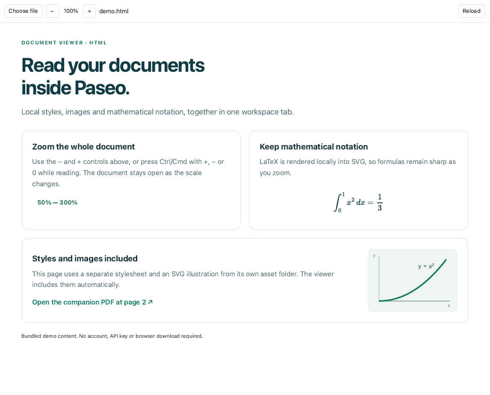

# Document viewer for Paseo

Read local HTML and PDF files in a Paseo workspace tab. Open a document from the existing file tree, the Documents sidebar button, or the Command Center.



Standalone preview of the shipped panel component, using the bundled sample files.

## Install

Requires **Paseo 0.11.2–0.11.x**, Node.js 22.22 or later, and npm on the daemon host.

```sh
paseo plugin add git:no-carve-only-pizza/paseo-document-viewer --ref v0.2.0
```

You can also paste that Git source into Settings → Plugins. Installation downloads the locked npm dependencies and prepares the PDF engine. No extra Chromium download or separate web server is needed.

## Use

- Click an HTML or PDF file in the file tree. It opens in the Documents tab.
- For HTML, use **− / percentage / +** to zoom from **50% to 300%**. Clicking the percentage resets it to 100%. Ctrl/Cmd with +, − or 0 also works while the document has focus. Zoom does not reload the document.
- HTML styles, images, fonts and classic scripts are included from the document's own folder. LaTeX is rendered locally as SVG. Relative links to PDF files preserve `#page=N`.
- For PDF, use page navigation, zoom, fit width, text selection and search. Passwords are used only to open the document and are not saved.
- Choose file opens a folder browser. Reload reads the current file again. The client remembers the last document path per workspace, not its contents.

Controls use English or Korean according to the browser/system language. See [한국어 안내](README.ko.md).

## Limits and privacy

Desktop and web previews are supported. Native iOS and Android show a notice instead of rendering documents. The current implementation was checked on macOS; CI checks the build and regression tests on Linux.

The existing file-tree connection uses a version-scoped DOM adapter because Paseo 0.11 has no public file-preview replacement API. The standalone Documents panel remains available if that layout changes. The manifest is capped below Paseo 0.12 so compatibility can be checked before enabling a new major API version.

HTML resources must resolve inside the document folder, including after resolving symlinks. Remote CDNs, API-dependent pages and ES modules are not loaded. PDF files up to 64 MiB are supported. PDF resources are prepared locally and delivered through Paseo's existing connection.

Documents run in an opaque-origin iframe. Inline scripts can run, but cannot read the Paseo parent DOM, cookies or storage. External resource requests, forms and nested frames are blocked. As with Paseo's built-in preview, browser policy cannot completely prevent a document from navigating its own frame. There is no telemetry or analytics.

## Support

If you find this plugin useful, you can [support its development on GitHub Sponsors](https://github.com/sponsors/no-carve-only-pizza). One-time and monthly sponsorships start at $1, and you can choose your own amount.

## Development

```sh
npm ci --ignore-scripts
npm run build
npm run typecheck
npm test
npm run lint
npm run format:check
```

Build prepares relocatable PDF resources from the pinned dependency tree. Generated assets contain no installation-specific paths. The example documents are in `examples/`; their contents are synthetic.

This project is Apache-2.0 licensed. Third-party notices are in `NOTICE` and `licenses/`.
